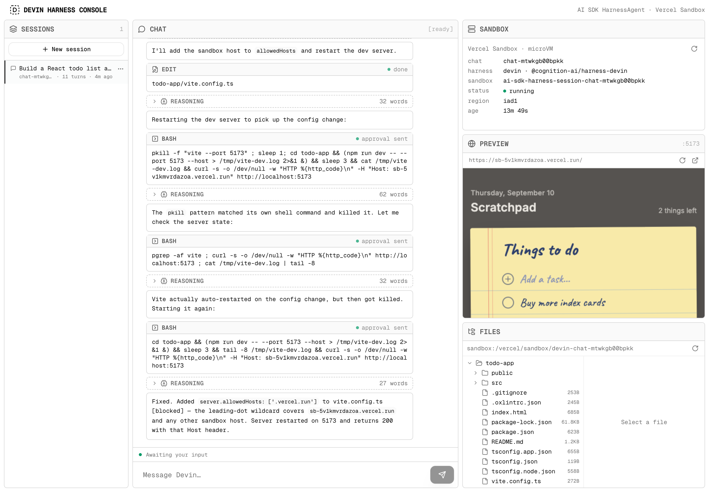

# Devin harness chat

A Next.js chat where the [AI SDK `HarnessAgent`](https://ai-sdk.dev/docs/ai-sdk-harnesses)
runs Devin inside a [Vercel Sandbox](https://vercel.com/docs/vercel-sandbox), streamed to
`useChat`. Devin edits files, runs commands and calls your server-side tools in an isolated
microVM; the chat keeps its session across requests and deploys.



[](<https://vercel.com/new/clone?repository-url=https%3A%2F%2Fgithub.com%2FCOG-GTM%2Fdevin-sdk-examples%2Ftree%2Fmain%2Fharness-chat&project-name=devin-harness-chat&repository-name=devin-harness-chat&env=DEVIN_API_KEY,HARNESS_CHAT_PASSWORD&envDescription=DEVIN_API_KEY%3A%20Devin%20personal%20access%20token%20(cog_%E2%80%A6).%20HARNESS_CHAT_PASSWORD%3A%20the%20password%20that%20gates%20the%20deployment.&envLink=https%3A%2F%2Fapp.devin.ai%2Fsettings%2Fapi-keys&products=%5B%7B%22type%22%3A%22integration%22%2C%22protocol%22%3A%22storage%22%2C%22productSlug%22%3A%22upstash-kv%22%2C%22integrationSlug%22%3A%22upstash%22%7D%5D>)

The button provisions the Upstash Redis store and asks for your `DEVIN_API_KEY` and a
`HARNESS_CHAT_PASSWORD`; Vercel Sandbox authenticates automatically on Vercel.

> This is a single-user demo: there are no user accounts. `middleware.ts` gates every page and
> API route behind the one shared `HARNESS_CHAT_PASSWORD` (HTTP Basic Auth — any username,
> that password; scripts can send `Authorization: Bearer <password>`), and serves nothing
> while it is unset. Everyone who knows the password can open every session and run Devin
> turns on your `DEVIN_API_KEY`, so keep it strong and private, and consider
> [Vercel Deployment Protection](https://vercel.com/docs/deployment-protection) on top.

## How it fits together

```
your server (Next.js route)                Vercel Sandbox (one per chat)
┌────────────────────────────────┐   ws    ┌──────────────────────────────┐
│ HarnessAgent                   │◄───────►│ bridge  ──►  devin acp (CLI) │──► Devin
│  harness: createDevin()        │         │  cwd = /vercel/sandbox/devin-<chat>
│  tools (AI SDK) ◄──────────── relay ─────┤                              │
│  resume state → Upstash Redis  │         └──────────────────────────────┘
└────────────────────────────────┘
```

- `lib/agent.ts` — the agent: `createDevin()` + `createVercelSandbox()`. Add AI SDK `tools` here
  and they run on your server, relayed into the sandbox.
- `middleware.ts` — the access gate: every request must carry `HARNESS_CHAT_PASSWORD`.
- `app/api/chat/route.ts` — the `useChat` route. Resumes the chat's session, streams the turn,
  parks the session (`detach()`) when the stream settles. One turn per chat at a time.
- `lib/session-store.ts` — resume state in Redis, keyed by chat id (which is also the harness
  `sessionId`, and therefore the sandbox name).
- `lib/workspace.ts` — read-only view into a chat's sandbox (status, files, preview URL) for the
  side panels; the lifecycle itself belongs to `HarnessAgent`.

## Run locally

Local development uses the real Vercel Sandbox too — there is no local sandbox emulation, so
what you see here is what runs in production.

```sh
cd harness-chat
bun install                           # @cognition-ai/* from npm (the pinned betas)
vercel link                           # pick or create the project (once)
vercel env pull                       # writes .env.local: VERCEL_OIDC_TOKEN, KV_REST_API_*, REDIS_URL
echo 'DEVIN_API_KEY=cog_…' >> .env.local
echo 'HARNESS_CHAT_PASSWORD=…' >> .env.local  # the browser asks for it once
bun run dev                           # http://localhost:3210
```

`vercel env pull` needs the Upstash integration on the project; add it from the Vercel
dashboard (Storage → Upstash) if you didn't deploy with the button. The OIDC token expires
after a while — rerun `vercel env pull` when sandbox calls start failing with an auth error.

`@cognition-ai/harness-devin` and `@cognition-ai/sdk` are pinned to the same published beta;
bump them together when a new beta ships (`bun add @cognition-ai/sdk@beta @cognition-ai/harness-devin@beta`).
