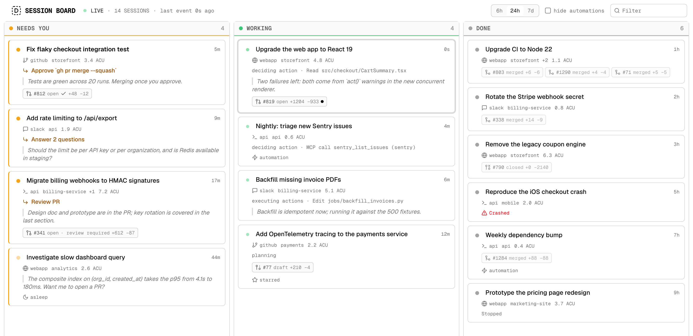

# Session board

Every cloud session on one screen, grouped by whether Devin is **working**, **needs you**,
or **done** — updated the moment anything changes, with no per-session polling. A Next.js
app: the server holds one connection to Devin, the browser watches the board move.



Each card is one session: its title, where it was started and on which repos, the one
thing you have to do (when there is one), what Devin is doing right now, the last thing
it said, and its pull requests. A card lights up when it changes and moves columns as the
session's status does. Clicking it opens the session in the Devin web app.

> Whoever can open the board sees every session `DEVIN_API_KEY` can see — titles, prompts,
> messages, repositories and pull requests — so every request has to carry a second
> secret, `BOARD_TOKEN`. The server serves nothing until one is set; a browser signs in
> once at `/login`, a script sends it as `Authorization: Bearer …`. It is one shared
> token, not accounts: for a team, put the board behind your own identity-aware proxy too.

| File                                                           | Role                                                                                                                 |
| -------------------------------------------------------------- | -------------------------------------------------------------------------------------------------------------------- |
| [lib/board.ts](lib/board.ts)                                   | The board, server-side: `createDevin()`, seed from `listSessionsPage()`, `attach()` + `session.events()` per session |
| [lib/card.ts](lib/card.ts)                                     | The wire model both sides share: `Card`, its columns, the `BoardEvent` stream                                        |
| [app/api/board/stream/route.ts](app/api/board/stream/route.ts) | The board as server-sent events: a snapshot on connect, then a `card` per change                                     |
| [middleware.ts](middleware.ts) + [lib/auth.ts](lib/auth.ts)    | The door: `BOARD_TOKEN` as a bearer header or the cookie `/api/login` sets, or nothing                               |
| [lib/use-board.ts](lib/use-board.ts)                           | The browser's copy of the board, fed by `EventSource`                                                                |
| [app/board.tsx](app/board.tsx)                                 | Columns, window / search / automation filters, the live indicator                                                    |
| [components/session-card.tsx](components/session-card.tsx)     | One session as a card                                                                                                |
| [Dockerfile](Dockerfile)                                       | The deployable: one container that talks to Devin's cloud                                                            |

## How it works

```
browser tabs ◄── SSE /api/board/stream ── Next.js server ── one WebSocket ──► Devin cloud
                                          lib/board.ts        attach() × every session
```

- One `createDevin()` connection, on the server, shared by every tab. `listSessionsPage()`
  seeds a card per session from the `_meta` each entry carries (`statusEnum`,
  `userActionRequired`, `pendingRequest`, `currentActivity`, `sessionOrigin`,
  `sessionRepos`, `sessionPRs`, `isUnread`, …), so the board is right before any live
  update arrives.
- `devin.attach(id)` joins each session and `session.events()` yields every update for it
  as typed events — from turns started in the web app, Slack, or another script alike.
  A `status` event moves the card and names the ask; `activity` and `tool_call` say what
  Devin is doing; `message_delta` keeps the last thing Devin said, which becomes the ask
  when the cloud does not name one; `pull_request` marks a PR as changed until the next
  scan refreshes it; a `permission_request` tool call turns into "Approve …" until it is
  answered.
- Every 30 s `listSessionsPage({ updatedAfter })` runs again to attach to sessions created
  or updated since, following pagination until all results have been read. Scans also
  refresh what live events only invalidate (pull requests) or never carry (unread,
  starred, ACU), and repair any transition the board missed while disconnected: a row
  newer than the card's last live update wins.
- Observers leave `onPermission` unset: an observer's answer to a permission request is a
  real decision, and the client driving the session should keep it. Clicking a card takes
  you to the web app, where you answer it.
- The columns follow the sidebar in the Devin app: `blocked` / `paused` / `waiting` is
  **needs you**, `finished` / `stopped` is **done**, everything else is **working**. A
  crashed or quota-limited session says so on its card; a session whose machine is asleep
  shows a moon while something is still expected of it.
- `/api/board/stream` sends the current board as a `snapshot`, then a `card` per change
  (at most every 200 ms per burst — streaming deltas arrive per token) and a `connection`
  note whenever the board's own link to Devin changes. `EventSource` reconnects on its
  own and every connection starts with a fresh snapshot, so the browser keeps no
  bookkeeping. If the WebSocket to Devin drops, the board reconnects, re-scans and
  re-attaches everything. Cards carry previews, not transcripts: the last line of
  Devin's last message and the latest tool title, each clipped to 200 characters. At most
  64 streams are open at once; past that the route answers 503 until one closes.
- [middleware.ts](middleware.ts) runs before every page and route. With no `BOARD_TOKEN`
  (16+ characters) it answers 503 to everything. Otherwise a request passes with
  `Authorization: Bearer $BOARD_TOKEN` or the `HttpOnly`, `SameSite=Strict` cookie that
  `POST /api/login` sets when the form at `/login` sends the right token — an HMAC under
  the token, so the token itself never reaches the browser and rotating it signs everyone
  out. A browser without either is sent to `/login`; anything under `/api/` gets 401. The
  stream route checks on its own as well, so a matcher mistake cannot open it.

Attached sessions are cheap: one WebSocket and a few megabytes for hundreds of them; idle
sessions send nothing. So the board stays attached after the last tab closes, and a tab
that opens later gets a current snapshot at once instead of waiting for a scan. The window
picker (6h / 24h / 7d) widens what the server follows; "hide automations" and the filter
box are applied in the browser.

## Setup

```sh
cd session-board
bun install        # @cognition-ai/sdk from npm (the pinned beta)
```

## Run

```sh
export DEVIN_API_KEY=cog_…      # app.devin.ai → Settings → API keys
export BOARD_TOKEN=$(openssl rand -hex 24)   # what the board asks for at /login
bun run dev                     # http://localhost:3211
```

Open the board, paste the token, and start a turn in one of the listed sessions from the
web app to watch its card move. From a script:

```sh
curl -N -H "Authorization: Bearer $BOARD_TOKEN" 'http://localhost:3211/api/board/stream?window=24h'
```

## Deploy

One long-running process — the WebSocket to Devin lives in it — so it wants a host that
keeps a container up: a VM with `systemd`, ECS, Fly, Railway. Not serverless: a function
instance would have to hold that socket and the board across requests, and every tab
would get its own. The [Dockerfile](Dockerfile) builds it:

```sh
docker build -t session-board .
docker run -p 3211:3211 -e DEVIN_API_KEY -e BOARD_TOKEN session-board
```

Two stages: the first installs and builds with Bun, the second copies only Next's
[standalone output](https://nextjs.org/docs/app/api-reference/config/next-config-js/output)
onto a plain Node image and runs it as the unprivileged `node` user (about 450 MB, most of
it Node itself).

The configuration is `DEVIN_API_KEY` and `BOARD_TOKEN`. Whoever has the token sees every
session the key can see, so treat it like the key: generate it, pass it as a secret, and
rotate it to sign everyone out. The cookie is only marked `Secure` when the request
arrived over HTTPS (or `X-Forwarded-Proto: https` from your proxy), so serve the board
over TLS before sharing a URL.
